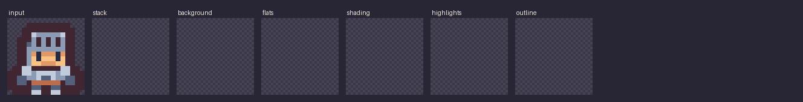

# spritesplit



**Decompose a pixel-art sprite into the layers artists actually work in:**
outline, flats, shading, highlights, background. Open the result in Krita,
GIMP or MyPaint and edit it like you painted it that way.

- **No AI, no GPU, no network.** Pixel art has a quantized palette, so every
  pixel is exactly one palette entry and the split is *computed*, not guessed.
- **Lossless.** Stacking the layers back reproduces your sprite exactly.
- **Deterministic.** The same PNG gives byte-identical output on Linux,
  Windows and macOS (enforced in CI).
- Works on any pixel-art PNG: hand-drawn, from an asset pack, or generated.

The top row of the demo is a CC0 sprite from Kenney's
[Tiny Dungeon](https://kenney.nl/assets/tiny-dungeon); the bottom row is a test
fixture.

## Install

```sh
uv tool install git+https://github.com/kotebibo/spritesplit   # or: pipx install git+https://github.com/kotebibo/spritesplit
```

From a checkout: `uv sync`, then `uv run spritesplit ...`.

## Use

```sh
spritesplit hero.png                   # writes hero.ora
spritesplit hero.png -o out/hero.ora --layers-dir out/hero --report out/hero.json
spritesplit hero_4x.png --scale 4      # upscaled input is detected; --scale re-upscales output
```

| Layer | Contains |
|---|---|
| `outline` | the line around the sprite (1 or 2 px), internal lines, or sel-out edge pixels |
| `highlights` | pixels lighter than their material's base colour |
| `shading` | pixels darker than their material's base colour |
| `flats` | every material filled with its single base colour |
| `background` | a flat background colour, if the sprite had one |

`--report` writes JSON describing the palette, every ramp (dark → light, with
its base), shared colours and the outline mode.

## How it works

The core is **palette ramp detection**. Pixel artists build palettes as ramps:
one material at several light levels, usually *hue-shifted* (shadows lean
blue/purple, highlights lean yellow). Spritesplit links colours into ramps one
lightness step at a time in OKLab, using which colours actually touch in the
sprite as evidence, and keeps only mutual-best links. The biggest-area member
of each ramp is its base (the flat); darker members are shading and lighter
ones are highlights. The outline is found *topologically*: a colour band that
hugs the silhouette, encloses it, and stops. Darkness alone doesn't make an
outline, so black hats stay hats.

Full walkthrough, with the reasoning behind every threshold:
**[docs/ALGORITHM.md](docs/ALGORITHM.md)**.

## Limitations (honest ones)

- **Pixel art only.** Painterly or anti-aliased art with thousands of colours is
  refused (`--max-colors`). That would need ML segmentation, which is out of scope.
- **Materials that share one ramp can't be separated by colour.** If skin and
  leather use the same ramp, the leather lands in "shading". Telling them apart
  needs body-part understanding, which is a non-goal.
- **Where a black fill meets a black outline**, the two are indistinguishable,
  and those outline pixels go with the fill.
- Outlines thicker than 2 px aren't detected as outlines.
- Output PNGs inside the `.ora` are uncompressed. That is the price of
  byte-identical output across zlib versions, and it's negligible at sprite sizes.

## Roadmap

1. **Decomposer** (this release): CLI, `.ora` output.
2. `.psd` export and an optional Aseprite extension.
3. Optional local generation (SD 1.5 + an existing pixel-art LoRA on a 4 GB
   GPU): grid-snap → quantize → hand to the decomposer.
4. Maybe a custom LoRA, trained **only on CC0 / public-domain sprites** with
   every source documented, and evaluated with the decomposer itself as the metric.

The decomposer is the product; generation will always be optional.

## Development

```sh
uv sync
uv run pytest                              # unit + fixture + golden tests
uv run ruff check . && uv run ruff format --check .
uv run python scripts/make_fixtures.py    # regenerate synthetic fixtures + expected.json
uv run python scripts/update_golden.py    # after an intentional output change; review the PNG diffs
uv run python scripts/make_demo.py        # docs/demo.gif
```

Fixture provenance: [tests/fixtures/SOURCES.md](tests/fixtures/SOURCES.md).
Only generated or CC0 art is ever committed.

## License

MIT. Kenney fixture sprites are CC0.
